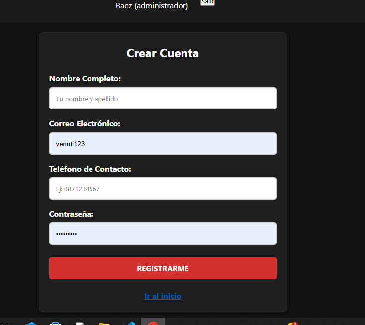
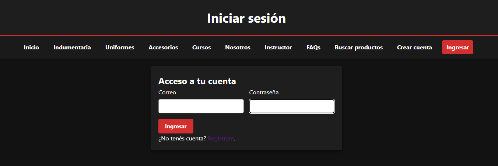
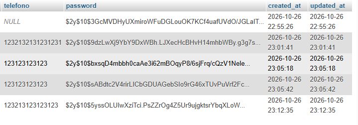
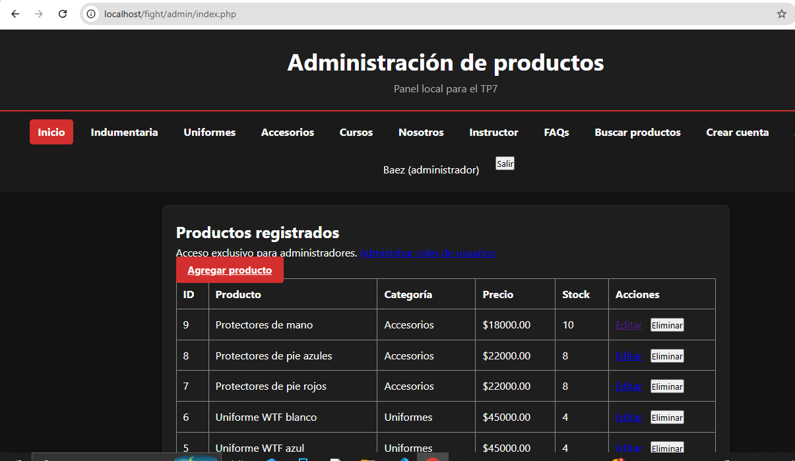
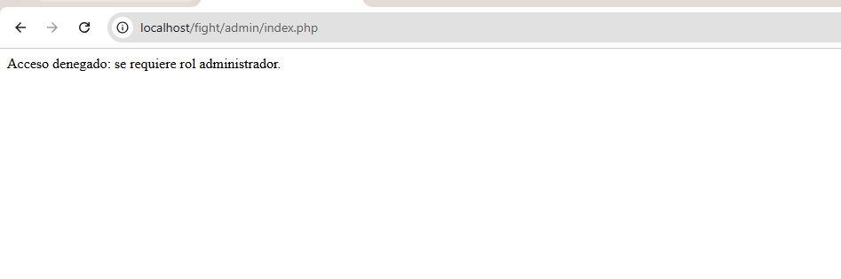

# TP8 — Registro, login, sesiones y control de acceso

**Proyecto:**  Impact Fight  

## Objetivo del trabajo

Implementar el registro de cuentas, autenticación de usuarios mediante contraseña, sesiones PHP, restricciones por roles y cierre de sesión.

## Desarrollo observado

Las capturas muestran el formulario de **Crear cuenta**, la pantalla de **Iniciar sesión**, una columna `password` con valores de tipo hash almacenados en MySQL, una vista administrativa accesible para un administrador y el mensaje de **acceso denegado** al abrir una ruta administrativa sin los permisos correspondientes.

El código del proyecto debe generar hashes con `password_hash()` y verificarlos con `password_verify()`, ejecutar `session_start()` cuando corresponda y regenerar el ID al iniciar sesión con `session_regenerate_id(true)`. El permiso de administrador debe validarse en el servidor, no únicamente ocultando enlaces del menú.

## Evidencias del TP8

**1. Formulario de registro.**

**2. Pantalla para ingresar.**

**3. Hash de contraseñas almacenado en MySQL.**

**4. Acceso al panel administrativo.**

**5. Protección de ruta administrativa.**

## Pruebas adicionales necesarias

- **Logout:** falta una captura del cierre de sesión y de que una ruta protegida ya no abre después de salir.
- **Registro real:** el formulario está visible, pero debe comprobarse que el nuevo usuario se guarda y puede iniciar sesión.
- **Seguridad:** verificar en el código la implementación de `password_hash()`, `password_verify()`, `session_regenerate_id(true)`, el manejo de cookies y los permisos del usuario común.

> **Privacidad:** antes de publicar capturas de phpMyAdmin en un repositorio público, revisá si contienen teléfonos, correos u otros datos personales. En la captura del hash aparece una columna de teléfono; ocultá esa información si no es ficticia. No subas credenciales, claves, cookies ni `.env`.

## Conclusión

Las sesiones permiten mantener al usuario autenticado entre páginas, mientras que la comprobación de roles protege las funciones administrativas. El cierre de sesión y la verificación de rutas protegidas completan el control de acceso.
